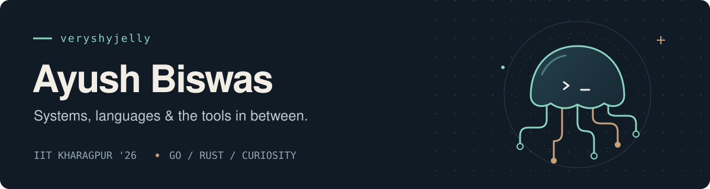

  

  <a href="https://www.linkedin.com/in/veryshyjelly/">LinkedIn</a> &nbsp; / &nbsp;
  <a href="https://www.boot.dev/u/veryshyjelly">Boot.dev</a> &nbsp; / &nbsp;
  <a href="https://github.com/veryshyjelly?tab=repositories">All repositories</a>

I'm Ayush. I like programming languages, systems, and making the software around my hobbies work the way I want. That has led to a competitive programming companion, a WhatsApp–Telegram bridge, and tools for vocabulary and Morse practice.

Mostly **Go and Rust**. Often somewhere between a terminal, an interpreter, and a new way to practice.

### From my workshop

<table>
<tr>
<td width="50%" valign="top">
<h3><a href="https://github.com/veryshyjelly/eitri">Eitri</a></h3>

A shorter loop from problem to solution. Bring a problem into your editor, save, and see the sample tests run.

<code>Go</code> · <code>Developer tools</code>

<a href="https://eitri.veryshyjelly.in">Get started ↗</a>

</td>
<td width="50%" valign="top">
<h3><a href="https://github.com/veryshyjelly/bifrost">Bifrost</a></h3>

WhatsApp and Telegram, connected. A self-hosted bridge that keeps track of delivery and recovers across restarts.

<code>Go</code> · <code>Messaging</code>

<a href="https://github.com/veryshyjelly/bifrost#readme">Explore the bridge ↗</a>

</td>
</tr>
<tr>
<td width="50%" valign="top">
<h3><a href="https://github.com/veryshyjelly/dih-dah-dojo">Dih Dah Dojo</a></h3>

Learning Morse by ear. Adaptive listening practice with a shared Rust core for the browser and a native trainer.

<code>Rust / WASM</code> · <code>Learning</code>

<a href="https://dojo.veryshyjelly.in">Try the studio ↗</a>

</td>
<td width="50%" valign="top">
<h3><a href="https://github.com/veryshyjelly/vocabulary-studio">Vocabulary Studio</a></h3>

A desktop home for vocabulary practice. A native app for Vocabulary.com, built around a reusable Go SDK.

<code>Go / TypeScript</code> · <code>Desktop</code>

<a href="https://github.com/veryshyjelly/vocabulary-studio#readme">See the app ↗</a>

</td>
</tr>
</table>

**Also on the workbench:** [CraftCoders CLI](https://github.com/veryshyjelly/craftcoders-cli), for running coding challenges locally.

### Under the hood

I also build the things I want to understand: a [Redis server](https://github.com/veryshyjelly/redis-rust), a [shell](https://github.com/veryshyjelly/shell-rust), a [Lox interpreter](https://github.com/veryshyjelly/lox-interpreter-rust), and [HTTP from raw TCP](https://github.com/veryshyjelly/httpfromtcp).

<b>Open the learning shelf</b> — Boot.dev, CodeCrafters &amp; computer systems

#### Boot.dev

[BookBot](https://github.com/veryshyjelly/bookbot) · [Asteroids](https://github.com/veryshyjelly/asteroids-pygame) · [AI agent](https://github.com/veryshyjelly/ai-agent-boots) · [Web scraper](https://github.com/veryshyjelly/webscraper-python-boots) · [HTTP from TCP](https://github.com/veryshyjelly/httpfromtcp) · [Git exercises](https://github.com/veryshyjelly/megacorp)

#### CodeCrafters

[Redis in Rust](https://github.com/veryshyjelly/redis-rust) · Shells in [Rust](https://github.com/veryshyjelly/shell-rust), [Go](https://github.com/veryshyjelly/shell-go), and [Gleam](https://github.com/veryshyjelly/shell-gleam)

#### Computer systems & languages

[Hack assembler](https://github.com/veryshyjelly/hack_assembler) → [VM translator](https://github.com/veryshyjelly/vm_translator) → [Jack compiler](https://github.com/veryshyjelly/jack_compiler)

[Lox interpreter](https://github.com/veryshyjelly/lox-interpreter-rust) · [RISC-V emulator](https://github.com/veryshyjelly/riscv_emulator) · [TCP in Rust](https://github.com/veryshyjelly/thunder)

#### Practice

[Competitive programming](https://github.com/veryshyjelly/cp_x) · [Exercism](https://github.com/veryshyjelly/exercism-codes)

